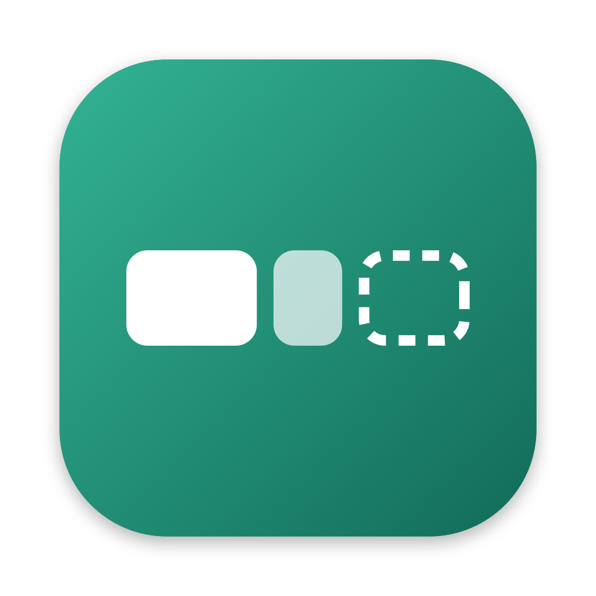
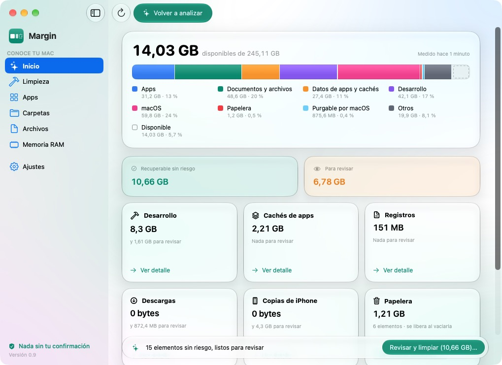
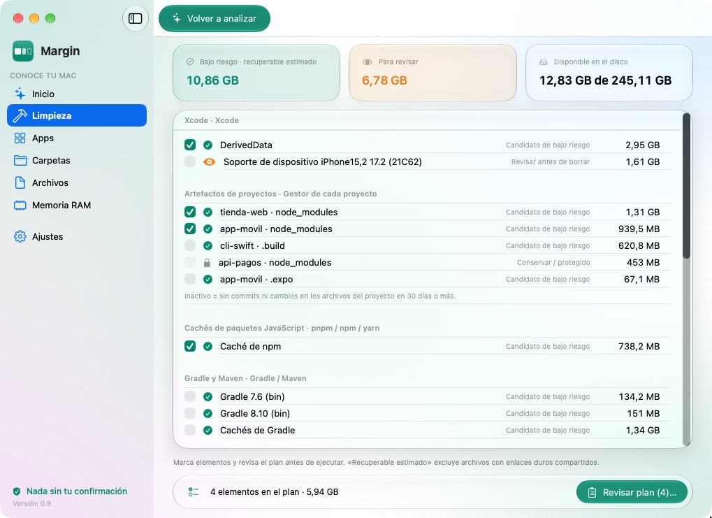
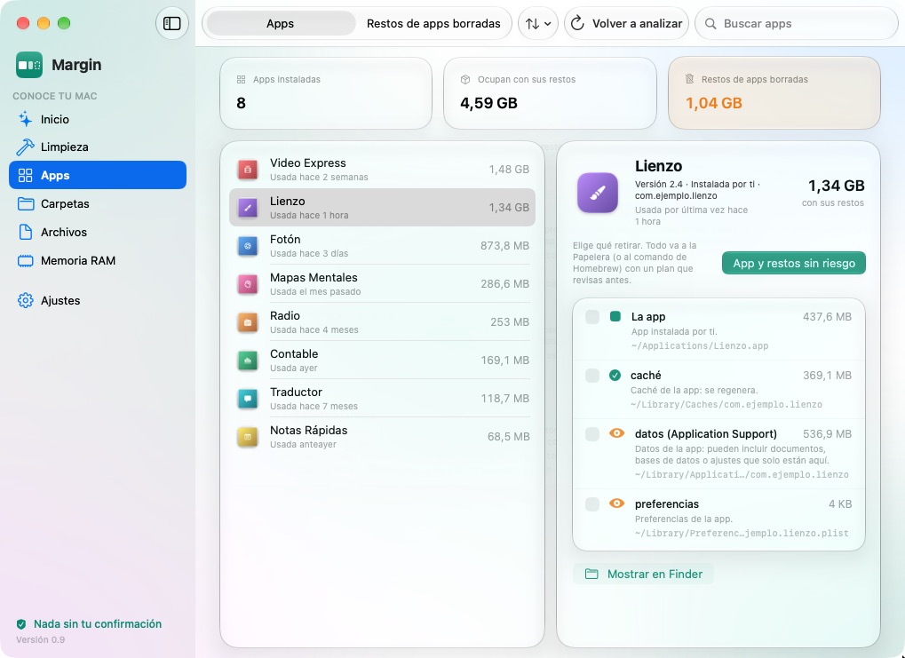
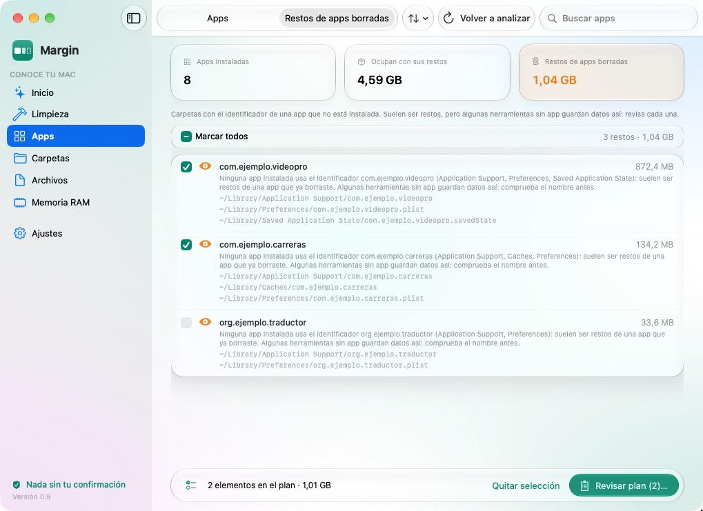
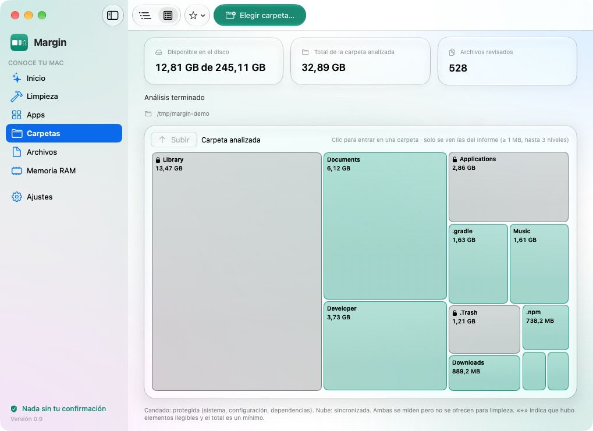

<p align="center">
  
</p>

<h1 align="center">Margin</h1>

<p align="center">
  <strong>Libera espacio en tu Mac sin sorpresas.</strong><br>
  Margin te enseña en qué se va el disco, te explica qué se puede quitar y por qué, y no borra nada sin tu confirmación.
</p>

<p align="center">
  macOS 26 o posterior · Español e inglés · <a href="https://github.com/jorgebuitragor/margin/releases/latest">Descargar la última versión</a> · Licencia GPL-3.0
</p>

<picture>
  <source media="(prefers-color-scheme: dark)" srcset="docs/capturas/inicio-oscuro.jpg">
  
</picture>

## Qué hace

### Ve en qué se va el disco

La pantalla de **Inicio** reparte el disco en apps, documentos, datos de apps, desarrollo, macOS, intercambio (swap), Papelera y lo que macOS puede purgar por sí mismo. Con el **análisis inteligente**, en unos segundos revisa los lugares donde se acumula espacio (cachés, registros, instaladores viejos, copias del iPhone, herramientas de desarrollo y la Papelera) y separa lo que se puede quitar sin riesgo de lo que conviene revisar.

### Limpia con explicaciones



Cada elemento dice qué es, por qué sobra, qué pasa si lo quitas y cuánto cuesta regenerarlo. Margin conoce bien las herramientas de desarrollo: `node_modules` y compilaciones de proyectos que llevan semanas sin tocarse, DerivedData y simuladores de Xcode, SDK y emuladores de Android, Gradle, Maven, npm, pnpm, yarn, Docker, Homebrew y versiones viejas de Node. Cuando una herramienta tiene su propio comando de limpieza (`brew cleanup`, `pnpm store prune`, `xcrun simctl delete unavailable`…), Margin usa ese.

### Desinstala apps con todo lo que dejan

<picture>
  <source media="(prefers-color-scheme: dark)" srcset="docs/capturas/apps-oscuro.jpg">
  
</picture>

Cada app aparece con lo que ocupa junto con sus restos en `~/Library` y cuándo la usaste por última vez. Eliges qué quitar: la app, su caché, sus datos o sus preferencias, cada uno con su nivel de riesgo. También encuentra **restos de apps que ya borraste**, y puedes marcarlos todos de una vez.



### Explora cualquier carpeta



El mapa de **Carpetas** muestra cada carpeta en proporción a lo que ocupa; con un clic entras en ella. **Archivos** lista los más grandes con una explicación de cada uno. Lo que está sincronizado con iCloud, Google Drive, Dropbox u OneDrive se mide pero nunca se propone.

### Y además

- **Vaciar la Papelera** desde la app: botón con su tamaño en la barra de Inicio, clic en su tramo de la barra del disco, menú Margin o ⇧⌘⌫ como en Finder.
- **Aviso de poco espacio**: una notificación cuando el disco baja del umbral que elijas.
- **Rendimiento**: uso de CPU y apps que más CPU usan, presión de memoria e intercambio, temperatura, tiempo encendido y, en portátiles, la salud de la batería.
- **Permisos** en Ajustes: acceso total al disco, notificaciones y control de Finder, cada uno con su estado y un botón para activarlo.
- **Actualizaciones automáticas** desde GitHub Releases, firmadas.
- **Accesibilidad**: colores aptos para daltonismo, más contraste, «Reducir movimiento», tema claro u oscuro.
- **Terminal y agentes**: la CLI `margin` y un servidor MCP para Claude Code o Codex. Los agentes pueden proponer limpiezas, pero solo tú las aplicas.

## Nada sin tu confirmación

- **Primero un plan.** Lo que elijas se reúne en un plan que revisas entero antes de ejecutar nada.
- **Todo se vuelve a comprobar justo antes de actuar.** Si un archivo cambió, si un proyecto volvió a usarse o si la app dueña está abierta, ese paso se bloquea.
- **A la Papelera.** Margin mueve las cosas a la Papelera, así que puedes recuperarlas desde Finder hasta que la vacíes. El borrado definitivo existe, pero viene **apagado** y, si lo activas en Ajustes, cada plan te lo recuerda.
- **Lo tuyo no se toca.** Documentos, configuración, credenciales, carpetas sincronizadas y las apps de Apple se miden, pero nunca se proponen.
- **Nada sale de tu Mac.** Margin no lee el contenido de tus archivos (solo tamaños y fechas) y no envía datos a ningún sitio. Lo único que hace en red es consultar una vez al día si hay una versión nueva en GitHub, y se puede apagar.

## Instalar

**Descarga** `Margin-<versión>.zip` de la [última versión](https://github.com/jorgebuitragor/margin/releases/latest), descomprímela y mueve Margin a Aplicaciones. Como no está notarizada por Apple, la primera vez ábrela con clic derecho › Abrir. Después se actualiza sola. Para usar `margin` en la terminal: `ln -s /Applications/Margin.app/Contents/Helpers/margin ~/.local/bin/margin`.

**O compílala** con Xcode y Swift 6 instalados, desde la carpeta del proyecto:

```bash
bash scripts/install.sh
```

Instala `~/Applications/Margin.app` y el comando `~/.local/bin/margin` (un enlace a la CLI que va dentro de la app), sin permisos de administrador. Para que macOS recuerde los permisos que le des a Margin entre versiones, crea antes una identidad de firma local (solo existe en tu llavero):

```bash
bash scripts/firma-local.sh
```

Opcional: en Ajustes › Permisos de Margin puedes darle **Acceso total al disco** (para medir la Papelera y las copias del iPhone), notificaciones y control de Finder.

## Desde la terminal

```bash
margin disco --text          # la barra del disco por categorías
margin dev --text            # el análisis de desarrollo, con un id por elemento
margin plan <id> <id>        # crea un plan; no ejecuta nada
margin apply <plan>          # lo revisa otra vez y pide escribir el código del plan
```

`margin apply` solo funciona en una terminal interactiva: un agente puede crear planes, pero no aplicarlos. Para conectar Margin con Claude Code o Codex: `bash scripts/install-agentes.sh`.

## Más información

- [Referencia técnica](docs/REFERENCIA.md): cada función, las garantías de los planes, la CLI, el servidor MCP y las pruebas.
- [Cómo clasifica Margin](CLASIFICACION.md) lo que encuentra.
- [Novedades de cada versión](CHANGELOG.md), [plan por versiones](PLAN.md) y [evidencias de verificación](VERIFICACION.md).

Las capturas son de una carpeta personal ficticia creada con `scripts/demo-home.sh`: ninguna muestra datos reales.

## Licencia

Margin es software libre con licencia [GPL-3.0](LICENSE): puedes usarlo, estudiarlo, modificarlo y compartirlo. Si distribuyes una versión modificada, tiene que ser con la misma licencia y con su código fuente.

Copyright © 2026 Jorge Andrés Buitrago Romero. Margin no está notarizada por Apple ni se distribuye en la App Store.
